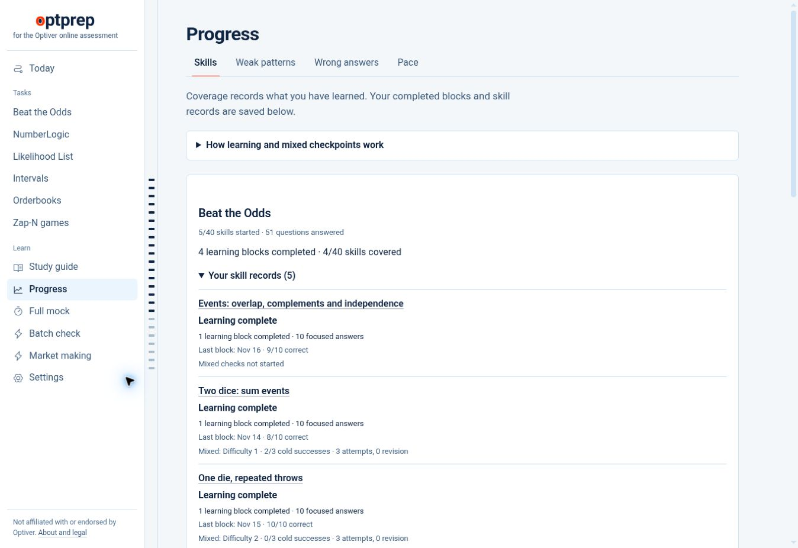

# OptPrep — probability curriculum edition

**1.6.0-kickstarter.1 · 16 November 2026**

Complete application based on [Coflazo/optprep](https://github.com/Coflazo/optprep), with its original MIT licence and attribution preserved. This independent preparation application is not affiliated with or endorsed by Optiver.

This release builds on the delivered **1.5.0-kickstarter.1**. It audits the whole Beat the Odds practice curriculum against independent sources, adds justified missing practice, and preserves existing progress, focused learning and ten-question blocks.

The [comprehensive audit and implementation report](docs/BTO_CURRICULUM_AUDIT.md) contains the research/evidence hierarchy, all 34 original family reviews, exact additions, mathematical checks, difficulty judgements, Quant Sprint comparison and remaining gaps. The [previous README](docs/README_MIXED_PRACTICE_1.5.0.md) and earlier reports remain historical records.

## Run locally

Install **Node.js 20 or later**, extract the ZIP, and open a terminal in the inner folder containing `package.json` and `index.html`:

```sh
npm start
```

Open the localhost URL printed by the launcher. Normal practice needs no dependency installation, build, account, Python backend or compiled engine. Serve the app over HTTP; do not double-click `index.html`.

The ZIP includes the complete application, source, automated tests, optional backend and engine, documentation, evaluation evidence and licence. Installed dependencies, compiled outputs, credentials and personal training progress are excluded.

## Upgrade and keep progress

1. Export a backup in **Settings → Backup** before replacing deployed files.
2. Replace the application files at the **same browser address**. Accept the update notice and reload when offered.
3. Continue in the same browser. If moving to another address, browser or device, import your backup there.

The `optprep:v2` store, migration, practice snapshot schema, learning/cold-check rules, scoring and runner are unchanged. Existing coverage, XP, skills, historical scores, pace records, proofs, question history, settings and saved question/draft remain. New skills start unlearned: the denominator increases from **34 to 40 BTO skills**, without erasing completed work.

Keep one active training tab; the existing local store does not merge simultaneous conflicting writes.

## GitHub Pages

Extract the ZIP and commit the **contents of the inner application folder** at your repository root, including `index.html`, `app.js`, `src/`, `config/`, `assets/`, `.github/`, `.nojekyll` and `LICENSE`.

In **Settings → Pages**, choose **GitHub Actions**, enable Actions and push to **main**, matching the supplied workflow. Use the URL GitHub reports after successful deployment. The workflow assembles the browser files and creates a commit-specific offline cache including the new modules.

Uploading the ZIP itself, or placing the application an extra directory below the repository root, does not deploy it. No public repository or live Pages deployment was changed while producing this archive.

## What the audit found

The old curriculum was strong in conditioning, indicators, pattern overlap, stopping and random walks. Its separate foundations book already explained several general models. Ordinary BTO practice was less balanced: model selection, weighted payoffs, restricted counting, variance/covariance and nonuniform sums were thinner than the advanced processes.

Independent preparation sources support a curriculum covering event algebra, counting, conditioning/Bayes, independence, distributions, expectation, dependence, sequential reasoning, symmetry, extremes and basic approximation. They do not justify importing every advanced trading interview topic into this online assessment.

The additions fill the main practice gaps:

| New family | Levels | Reasoning demand |
|---|---|---|
| Events: overlap, complements and independence | 1,2 | Translate the event and identify overlap/conditioning without inventing independence |
| Success counts: recognise the sampling model | 1,2,3 | Choose binomial, depleted sampling or unequal-trial counts across coins, dice, cards and urns |
| Weighted payoffs and conditional expectation | 1,2,3 | Weight net/transformed payoffs and update source weights after information |
| Restricted counting: roles, groups and arrangements | 2,3 | Choose ordered/subset/multiset spaces and enforce adjacency, gaps and colour restrictions |
| Variance, covariance and shared risk | 2,3,4 | Distinguish scaling, independent copies, reuse, depletion and shared hidden sources |
| Combining discrete random quantities | 2,3,4 | Build weighted sum/comparison distributions and handle observed totals or random horizons |

The existing first-success skill additionally covers **memorylessness and the rth success on trial k**. Its complete level-2 pool grows from 22 to 197 prompts, retaining all its old prompt identities and levels. The Study lesson connects later-success waiting to the mean r/p.

The six new families have per-question worked explanations, misconception alternatives and full linked Study lessons. They appear in focused learning, mixed practice, Batch checks and mocks. No new mode or interface redesign is required.

The roadmap groups a skill by its easiest supported level. An Easy or Medium skill can have later harder levels. These levels are authored training distinctions, not independently validated Optiver difficulty bands.

### Every substantive modification

- Added six original rational-arithmetic generators with **42 selectable task branches** and structure/operation metadata.
- Added separate finite-outcome JavaScript verification, an independently written Python Fraction oracle and a reproducible input corpus.
- Expanded first-success generation and its complete finite catalogue; added Study guidance on memorylessness, later successes and stage means.
- Added six Study lessons, a new chapter, recognition-tree links and regenerated catalogues.
- Corrected urn replacement comparisons/counting language, expectation independence/median wording, gambler's-ruin stopping conditions, nonlinear-EV equality claims and Monty Hall host-policy explanations.
- Softened unsupported topic-frequency and exhaustive-coverage claims.
- Added branch, boundary, answer-choice, mutation and integration tests. Updated curriculum-count assertions and increased rare-input reachability coverage without removing difficult cases.
- Advanced the development service-worker cache marker. The Pages workflow and protected training/progress implementations remain unchanged.
- Retained the original licence, attribution and full earlier application. [BUILD_INFO.json](BUILD_INFO.json) and `SOURCE_REVISION.txt` record release provenance.

## Research and actual assessment relevance

Your invitation confirms **25 minutes overall for BTO and limited time per question**. The [official 2027 programme listing](https://www.optiver.com/join-us/jobs/trading/amsterdam/career-kickstarter-trading-2027/?gh_jid=8859789002) confirms the deadline **6 December 2026, 23:59 CET / 22:59 UK**. Public information does not provide a complete BTO syllabus or normed difficulty distribution.

The configured **20 questions, 90-second item budget, scoring and readiness thresholds remain trainer assumptions**, not newly verified requirements. Invitation-aligned overall section clocks, assessment categories and the Career Kickstarter preset are unchanged. Follow the instructions in your actual portal.

The independent standard also used [MIT's probability curriculum](https://ocw.mit.edu/courses/6-041-probabilistic-systems-analysis-and-applied-probability-spring-2006/pages/calendar/) and [Jane Street's primary probability/interview material](https://www.janestreet.com/probability-markets/). These support mathematical preparation choices, not a claim that Jane Street interview content is Optiver OA content. Recent candidate reports receive lower weight than your invitation; commercial replica claims are not independent calibration evidence.

[Rohrer and Taylor's mathematics practice study](https://digitalcommons.usf.edu/psy_facpub/1767/) supports spaced and mixed practice in its experimental settings. It does not validate this application or three-correct streaks as a complete measure of mastery.

Quant Sprint was inspected for multicolour sampling, restricted selections, conditioned counts and payout moments. Useful mathematical ideas informed independently implemented additions. Its source, UI, progress system and calibration claims were not copied wholesale.

## Use it consistently

| Activity | What to do | What the record means |
|---|---|---|
| Learn or repair | Ten focused questions; use ChatGPT, hints and solutions | All ten answered without skips ticks coverage; help/accuracy do not prevent learning completion |
| Mixed practice within BTO | Ten fresh questions without topic labels; choose the method independently | Three qualifying cold, paced successes at a supported difficulty earn that checkpoint |
| Review | Explain model/assumption errors and solve cleanly later | Diagnosis and correction, not a new cold success on a known answer |
| Batch check | Choose one assessment; feedback arrives at the end | Separate check; optional cross-category mixing is not required |
| Timed section/mock | Use configured clocks with no outside help | Sustained performance, distinct from learning coverage and checkpoints |
| External unfamiliar problems | Different source, no topic cue and a time budget | Evidence of transfer beyond the app's templates |

Start mixing after learning a few skills; do not wait until completing all 40. Keep learning new material while revisiting earlier skills. With ChatGPT, ask for the sample space, why the method applies, why an alternative fails and what changes when an assumption changes.

An eight-hour week across the battery can start with **3h BTO, 1h15 NumberLogic, 1h15 Likelihood-list, 1h Orderbooks, 45m Intervals, 15m Zap-N and 30m general error review**. Include unfamiliar external problems and a timed probability section within BTO time. Shift time toward measured weaknesses. A full mock replaces subject time rather than adding an extra obligation.

## Verification results

| Check | Current result |
|---|---|
| Full JavaScript / Python / C++ suites | **1,157 / 36 / 34 passed**: 1,227 unit tests |
| New mathematical branches | **5,376** explicit seeded JS outcome/contract checks |
| Independent Python Fraction oracle | **1,519** cases passed |
| Before/after all-level mathematical sample | **46,080** items verified |
| Display rounding/presentation | **25,088** samples, all keyed choices uniquely closest |
| Complete finite catalogues | **33 pools / 1,146 entries**, verified and reachable |
| DOM integration | **13 scripts passed**, including 200 new-family assertions |
| Whole learning walkthrough | **109 skills, 1,100 questions, 716 assertions**, no uncaught app errors |
| Focused/mixed/mock/Batch regression | **5,560** questions with **zero exact repeats**, including 150 mock papers |
| Visual QA | Desktop Chrome and a 390px iframe: saved draft/resume, completion, lessons, new variance feedback and retained synthetic progress |

Generation uses rational formulas/counting/convolution; new verification uses separately implemented finite paths, labelled subsets, Cartesian products, unique strings and centred deviations. The Python program imports no app code. These checks also cover zero probabilities, impossible arrangements, negative covariance, coefficient cancellation, complete-deck sampling and conditional-model changes.

See the [validation summary](evaluation/curriculum-validation.json), [before/after comparison](evaluation/curriculum-comparison.json), [question-quality results](evaluation/curriculum-question-quality.json), [Python results](evaluation/curriculum-python-oracle.json), [integration results](evaluation/curriculum-flows.json) and [browser observations](evaluation/curriculum-browser.json). Reports without the `curriculum-` prefix remain historical results for earlier releases.

Eleven protected files were byte-compared with the delivered baseline. Existing family IDs/levels and prior enumerated BTO prompt identities remain. Exact session repetition was already zero in the previous measured regression and remains zero here; this release improves breadth and structural contrasts.

### Reproduce

```sh
npm test
node tools/mixed-question-quality.mjs evaluation/curriculum-question-quality.json
node tools/focused-assessment-regression.mjs evaluation/curriculum-assessments.json
python tools/curriculum-oracle.py
```

The [full report](docs/BTO_CURRICULUM_AUDIT.md#11-running-and-reproducing) covers jsdom, optional backend/native tests and the comparison tool, which needs the separate preserved 1.5.0 checkout. The exported Python corpus is included and runs without that checkout. Node.js alone is sufficient for ordinary app use.

## Verdicts and remaining limitations

| Dimension | Verdict / confidence |
|---|---|
| Mathematical correctness | Strong on implemented models; high confidence in tested additions |
| Assessment realism | Useful preparation; moderate broad relevance, low confidence in exact replication |
| Difficulty calibration | Defensible internal progression; externally uncalibrated |
| Educational quality | Stronger assumption recognition and contrasts; moderately high confidence, no human trial |
| Overall usefulness | Good primary question-practice application alongside tutoring and independent problems |

The additions are meaningful structures, but remain authored templates. A new context alone is surface variation; changed replacement, dependence, conditions or constraints change the mathematical model. Software counts cannot establish human conceptual transfer.

Poisson/exponential models have basic foundation material but no comprehensive BTO generator coverage. General no-replacement waiting, unequal-category occupancy, arbitrary densities, general Markov reachability and advanced inequalities remain outside systematic practice. The report explains worthwhile short extensions and lower-priority material before the deadline.

Difficulty is not normed against Optiver. Some questions are stretch work. Correct letters are shuffled, but numerical-magnitude cues can remain. Domains are finite; bounded novelty searches do not establish infinite capacity. Unseen-only sessions do not silently recycle an unavailable question.

Use this as the **primary question-practice application**, with ChatGPT for understanding and external unfamiliar problems for transfer. The objective is reasoning that survives changed assumptions, rather than collecting marks on recurring templates.



## Licence and release history

[MIT licence](LICENSE), original attribution, [LEGAL.md](LEGAL.md), [PRIVACY.md](PRIVACY.md) and previous reports remain included. `SOURCE_REVISION.txt` identifies the tested local implementation; a following metadata-only commit records its provenance. This archive does not modify Coflazo's public repository.
