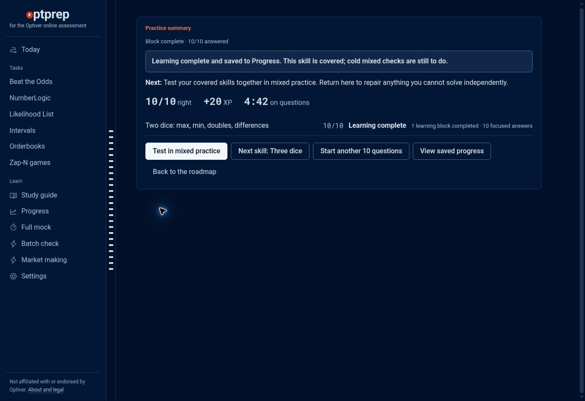
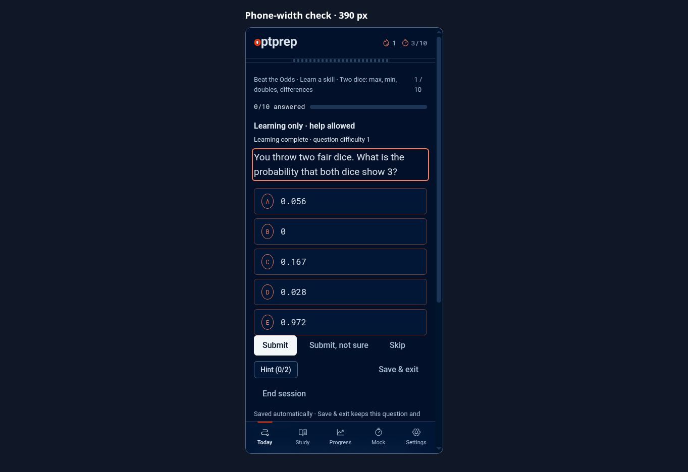

# Focused learning: freshness, scope and small pools

Version **1.4.0-kickstarter.1**, 15 November 2026. Baseline: the delivered 1.3.0-kickstarter.1 ZIP, SHA-256 `176ea2b8d00d5f1e40c02c610cfa3f47ac7eabdfa1a7779508920b9d40fdd231`.

## Investigation

The user reported identical questions inside a ten-question focused-learning block and asked for every topic to be checked without changing its difficulty or mathematical scope. The easy two-dice max/min/doubles/differences family supplied only seven visible instances. Other small domains also could not supply ten questions: basic cards and three dice each supplied four; introductory Monty Hall supplied two; best-of-series and coupon collection each supplied three; reroll values supplied five or three depending on level. These were confirmed from source and deterministic generator samples, not inferred from the interface.

The recovered modified application was used as the starting point. The original upstream repository was not rebuilt over it or modified. The baseline's complete README is retained at [README_REASONING_DIVERSITY_1.3.0.md](README_REASONING_DIVERSITY_1.3.0.md). Older statements that focused learning can deliberately recycle after depletion describe historical behaviour and are superseded by this document.

Every family file's random inputs, supported levels and parameter definitions were inventoried. The [per-level table](../evaluation/FOCUSED_VARIABILITY_INVENTORY.md) covers 103 invited reasoning skills plus eight optional arithmetic skills, across 273 supported skill/level combinations. [Machine-readable results](../evaluation/focused-variation-results.json) include 112 source files from ordinary and supplementary family modules, their hashes, and their input-definition lines. Counts of distinct questions were sampled with 512 deterministic seeds per level; a sampled count is never presented as a complete capacity.

## All generator modifications

All changes extend existing families at their existing authored difficulties. No generator was moved into another assessment. No arbitrary new level was created. The 84 other invited families and eight optional arithmetic families are byte-for-byte preserved. Likelihood List and Orderbooks already combine substantial numerical and relational inputs; their generators and Zap-N games were left intact.

| Existing family | Substantive change | Scope and reasoning value |
|---|---|---|
| BTO: dice-order-stats | Easy pool 7 → 26; higher 19 → 36. Complete endpoint ranges; specified doubles, unequal faces, non-losing comparison including ties, bounded maxima/minima; higher signed differences and bounded absolute differences. | Always two fair six-sided dice. Event predicates differ, so the learner must distinguish equality, inequality and direction. Boundary and certainty events remain legal. |
| BTO: die-repeats | Easy named-target event uses every legal face on the existing 4/6/8-sided dice, with two/three throws. Easy pool 18 → 48; higher pool 60 preserved. | Mostly numerical/event relabelling. Existing any-repeat and adjacent/return structures remain. The target face is explicitly stored; legacy items default to the old face. |
| BTO: three-dice | Difficulty 2 pool 4 → 17: original cases plus odd product, specified triples and specified pairs. Higher original branches retained. | Standard six-sided dice and 216 outcomes. Parity, exactly two equal and three equal are distinguished. |
| BTO: card-draws | Easy pool 4 → 21 using six standard-deck groups and both/first-only/neither events, deduplicating the original both-aces case. Higher pools 13/13 retained. | Real 52-card counts and draws without replacement. Group membership and shrinking denominators must be interpreted correctly. |
| BTO: monty-hall | Introductory difficulty 2 uses 3–12 doors with the knowledgeable host opening all but two; stay/switch pool 2 → 20. | The same informed-host procedure and one alternative closed door. Higher partial-reveal/random-host cases remain at their old level. This is not 20 concepts. |
| BTO: race-to-k | Difficulty 2 full-series event uses the original win targets 2–4 with five existing simple win probabilities; pool 3 → 15. | Same full-length-series question. Adds weighted counting while excluding the awkward 11/20 probability from this level. Higher full-versus-winner variants retained. |
| BTO: coupon-collector | Difficulty 2 enables all five existing contexts, with uniform item counts 3–10 where applicable; pool 3 → 19. | Uniform coupon stages, not new biased variants at the basic level. Contexts with fixed dice/coin counts remain fixed. Higher cases retained. |
| BTO: expected-extremes | Difficulty 2 has two dice with sides 3–12, max/min; pool 6 → 20. | Existing discrete extreme-value method, two dice throughout. Higher continuous and extra-dice cases remain intact. |
| BTO: dice-duel | Basic identical dice include 4/6/8/10/12 sides, pool 12 → 16. Higher Efron comparisons include all 16 ordered pairs, alongside existing sum/max cases; pool 8 → 18. | Same explicit face-list win probability. Same-die all-tie comparisons are valid and retained; not filtered to hide a zero edge case. |
| BTO: dice-games-ev | Existing reroll questions at difficulties 3/4 allow positive payout multipliers 1–5; pools 5 → 25 and 3 → 15. | Existing die sizes and roll counts. The policy remains in face points, while values/options convert consistently to dollars. Original stake-1 prompts remain unchanged for history compatibility. |
| BTO: first-success | Easy adds the first head on trial k for a fair coin to the existing exact/tail die cases, k 2–6; pool 10 → 15. | Same geometric logic, no arbitrary biased-coin calculation moved down. |
| BTO: coin-sequences | Easy number of tosses extends 3–5 to 3–6; pool 12 → 18. | Same all-same/exactly-k event definitions and binomial counting. Numerical expansion, not a new technique. |
| BTO: at-least-one | Hard double-six trial counts include every integer 8–30 instead of five selected counts; lottery inputs unchanged; hard pool 9 → 27. | Same complement and independent-trial method; lower levels preserved. |
| BTO: pattern-waiting | Binary patterns cover every string of length 2–4. Difficulty 3 samples all three lengths; 12 → 28 visible variants. Complete length-four input set also enriches the original higher branch. | Maximum length remains four. Different prefix/suffix overlaps matter; relabelled patterns with the same overlap are not claimed as new concepts. |
| BTO: uniform-geometry | Hard product thresholds use all 0.05 steps from 0.05 to 0.95, rather than a short list; hard pool 12 → 27. | Same unit-square product event and integration method. Lower geometry cases retained. |
| NumberLogic: triangular | Easy start index extends 1–7 to 1–12; sampled visible instances 11 → 21. | Same untransformed triangular rule and existing missing-term support. Higher affine transformations retained. |
| NumberLogic: fractions | Hard shown-term count can be 4–7 rather than fixed at five; sampled hard instances 8 → 35. | Existing Fibonacci/prime/square fraction constructions and ambiguity/reduction filters remain. Lower levels unchanged. |
| Intervals: waiting-time | Basic fair-binary patterns include lengths 2–4 rather than only 2–3; pool 12 → 28. | Same expected-waiting overlap method; die and biased cases remain at their old higher levels. |
| Intervals: expected-dice | Distinct-face roll counts extend 2–6 to 2–10; combined difficulty-3 pool 11 → 15. | Still six-sided dice and the same indicator-expectation problem. Original reroll questions retained. Verification uses exact state counts instead of exponentially enumerating all length-10 sequences. |

The expanded two-dice family has genuine additional event structures. Several other changes mainly supply more numerical practice. This distinction matters: more visible questions prevent answer memorisation, but do not automatically teach recognition of unfamiliar mathematics. Earlier conditioning, information-protocol, shared-source and sequence-gap improvements are retained and continue to supply structural variation.

## Selection, resume and exhaustion

`src/ui/runner.js` now requests strict fresh selection for ordinary focused learning as well as mixed practice. It freezes the focused difficulty once at block start, saves it in the snapshot and restores it on resume. A valid old snapshot without this field uses its saved current item's difficulty. Gaining cold evidence elsewhere cannot change the difficulty halfway through the block.

`src/core/practice.js` validates the optional saved difficulty and its agreement with the saved item. Existing schema versions are retained. No progress migration or reset is required, and the old current question, drafts and feedback survive upgrade.

`src/practice/finite-variants.js` now supplies complete input plans for 33 small family/level pools. These call the actual generators to construct items; they do not duplicate their answer formulas. Planned RNG calls are checked for valid ranges and consumption. Catalogue identity is tied to the actual family object, cached items are deeply frozen, and returned items are cloned.

`src/core/draw.js` selects a genuinely unencountered branch where possible, then an unseen instance. It groups by the existing branch signature before selection, so adding many target faces or numbers to one branch does not crowd out another method. Branch signatures are heuristics: they neither prove conceptual novelty nor guarantee an exact distribution of mathematical techniques.

The strict path rejects any repeated candidate. For a known single-family catalogue, it reports true exhaustion only after every configured item's key is present. Otherwise the existing bounded search remains bounded and a failure is described as a search limit. The UI saves a partial block, shows no automatic completion tick, and hides “Start another 10” after this stop. It offers another skill or mistake review. There is no automatic topic/difficulty substitution.

Low-level non-strict drawing remains available for intentional legacy/revision contexts. Its existence does not permit repetition in the focused UI, which explicitly requests strict freshness. Mistakes, lessons and fixed sets are not redefined as unseen tests.

History fingerprints still ignore answers/solutions and answer ordering. Existing ranking-statement and orderbook-card permutation protections are retained. The unchanged history cap is 8,000 keys per assessment. Freshness applies to that retained local history; it is not perpetual storage.

## Four adjacent correctness repairs

1. In the existing product-of-two-dice question, “average the extreme products” is `(1 + 36) / 2 = 18.5`, not 18. The correct expectation remains 12.25.
2. The two-outcome coupon-collection check now says the expectation is exactly 3. The old “above n + 1” claim is false for n = 2; it is valid for larger configured uniform domains.
3. An order-statistics misconception that divides an ordered numerator by the unordered denominator 21 now actually uses the ordered count. For minimum 1, it is 11/21, while the correct answer is 11/36.
4. The uniform-product distractor explanation now describes the mistaken square-root cutoff. The probability of both independent uniforms being below the square root of a is a, not the square root of a.

Correct answer values for these existing cases were already correct. The final full unit suite includes these repairs. They change no prompts, parameters, correct answers, fingerprints or question-selection RNG, so the preceding numeric variation comparison and UI flows remain applicable. Source hashes were refreshed after them and this ordering is recorded in the report.

## Mathematical checks

Every catalogue entry passes the contract and its family verifier. Every catalogue also receives 2,048 raw generator seed draws to test membership and reachability, plus tests for the last unseen item and true exhaustion. Scripted catalogues are small, explicit source domains; sampled reachability alone would not prove a hidden domain complete without that source inspection.

- Two-dice constraints are checked by all 36 ordered pairs and separate known boundary values.
- Three-dice additions are checked by all 216 outcomes.
- Card groups are independently built from actual ranks/suits; all 52 × 51 ordered distinct-card draws are counted.
- Series probabilities use independent exhaustive weighted outcomes; coupon/pattern cases retain Markov verification.
- Reroll values are checked by independently searching keep sets, then converting units. Legacy missing multipliers default to one.
- Continuous-product thresholds retain the independent Monte Carlo verifier and additionally receive Simpson integration of the unit-square area at all 19 thresholds.
- Expected distinct faces uses exact integer counts over the 64 seen-face masks. An independent seven-state count recurrence checks all n = 2–10; literal full-sequence enumeration for the original n ≤ 6 cases remains in regression tests. A deliberately incorrect truth value is rejected.
- Existing MCQ uniqueness, ambiguity, scoring, ranking equivalence, timing, presentation and snapshot checks remain. Correct scoring implementations were not replaced.

NumberLogic continuation is interpreted using the existing finite rule/ambiguity model, not a claim that a finite sequence has one logically possible continuation among all mathematical functions. No automated metric establishes how unfamiliar a person will find a problem.

## Evaluation results and limits

The before/after comparison uses the extracted 1.3.0 release, 20 seeded first blocks at every one of 273 levels, with empty history at the start of each seed. Each release supplies 54,600 questions. Repeated draws fall from **1,160 to zero**. All updated questions remain in the requested skill and difficulty. No updated level sampled fewer than ten visible questions in 512 raw draws.

A separate successive-draw stress test asks for up to 40 items per skill/level: **9,764 delivered, zero repeats, 64 stops**. Stops are expected when a finite or bounded search cannot supply another fresh item. They are not treated as passed complete blocks. For example, standard two-dice sums still has only 21 configured instances at each level: after two blocks the third can contain one fresh answer and then stop.

A shared-history regression supplies **1,030 learning questions, 1,000 mixed questions, 150 mock papers / 2,970 questions, and 500 Batch questions**, with no repeated questions. Synthetic correct cold answers exercise progression. This is an integration check, not an experiment on learner outcomes.

The complete current suites pass: **1,062 JavaScript + 36 Python + 34 C++ = 1,132 tests**, zero failures and no Python/JavaScript skips. Eleven DOM scripts pass. The full learning walkthrough covers all 103 invited families, 1,040 submitted answers and 680 assertions without uncaught errors. New focused UI checks cover assisted completion, unchanged cold credit, resume, frozen difficulty, three-item partial exhaustion and honest unknown-search failure.

In real Chrome, an old saved repeated-die question/block was resumed and finished. The user's exact two-dice topic then completed ten distinct easy questions, independently solved by enumerating the visible events. Save & exit, resume and a full reload after five answers retained question six. The summary showed learning complete and saved. A new question after the completed block was also fresh. Desktop and a 390 px responsive iframe were visually checked; the phone body had client and scroll widths of 375 px. A physical phone and other browsers were not tested.

Evidence: [validation summary](../evaluation/focused-learning-validation.json), [DOM flows](../evaluation/focused-learning-flows.json), [visible browser checks](../evaluation/focused-browser-results.json), [mode regression](../evaluation/focused-assessment-regression.json). The baseline and the optional development dependencies are needed to rerun the comparison, but not to run the app or its standard unit suite.

## Preserved behaviour and remaining uncertainty

The Kickstarter preset, deadline, assessment categories, clocks, scoring, cold-check rules, learning ledger, stored progress and prior mathematical fixes remain. The save format is backwards compatible. Service-worker fallback cache identity is bumped to `focused-unseen-1`, and package version to 1.4.0-kickstarter.1. GitHub Pages' workflow still uses a commit-based cache name. No interface redesign or new training mode was added.

The supplied invitation supports the section purposes and overall clocks. Counts, per-item seconds, scoring details, task distributions and trainer readiness thresholds remain assumptions where absent from that invitation. In particular, it does not give the app's 20-question/90-second Beat the Odds configuration. No new independent research or difficulty calibration was performed in this focused implementation task.

Judgment: this is a materially stronger question-and-mock platform, because avoidable duplicates are blocked and weak pools can supply useful full first blocks. Confidence is high in the tested selection and small-domain arithmetic; moderate in educational value, because the added structural distinctions are sensible but no learner trial was run. Difficulty calibration and real Optiver score effects remain unmeasured. Independent unfamiliar problems are still the appropriate check on transferable reasoning.

| Dimension | Verdict for this update | Confidence and basis |
|---|---|---|
| Mathematical correctness | Strong for the changed domains | High within tested assumptions: exhaustive finite checks, independent methods, retained edge cases and full regression suites. This is not a formal proof of the entire application. |
| Assessment realism | Categories and overall clocks preserved; exact formats remain partly assumed | High about what the supplied invitation states; limited for unprovided per-item clocks, counts and scoring. No new external validation was performed. |
| Difficulty calibration | Skill/level scope is preserved; real-test calibration remains unmeasured | High in the automated scope checks, moderate in judgments that the added numbers fit the existing levels, low in any proposed mapping to Optiver difficulty. |
| Educational quality | Better instance practice with some useful structural distinctions | Moderate: more event interpretations and less answer memorisation, but no experiment measuring learning or transfer. |
| Overall usefulness | A stronger daily practice interface, used alongside independent unfamiliar problems | High in the usability/freshness improvement; moderate in the expected assessment-preparation benefit. |

The release ZIP contains the entire application, source, tests and documentation. It excludes installed packages, compiled engine output, local git metadata and personal browser progress. The original MIT licence is unchanged. No public repository or live Pages deployment was modified.
